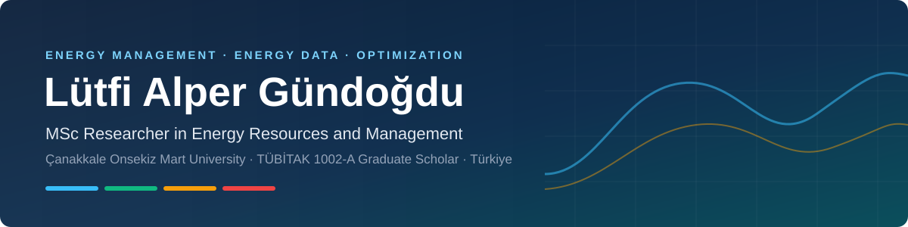
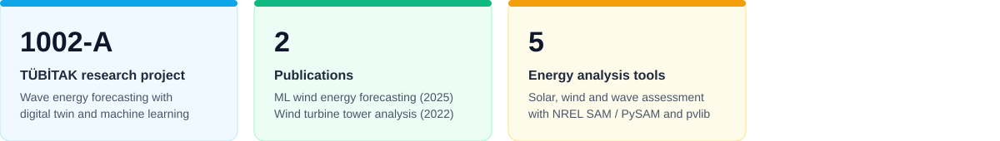
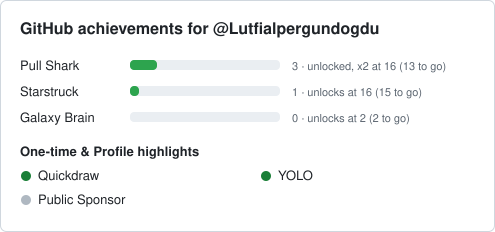

  

  
  
  
  
  

 

  

 

I am an Energy Management graduate doing an MSc in Energy Resources and Management at Çanakkale Onsekiz Mart University. As a scholarship student on a TÜBİTAK 1002-A project, I forecast the wave energy potential of the Çanakkale region with digital twin simulation and machine learning.

Outside the project I write my own energy analysis software in Python. My tools take open weather and sea data, run hourly yield calculations with NREL SAM (PySAM) and pvlib, and turn the results into P50/P90 ranges and reports that show where every number comes from. I also hold an associate degree in electrical energy generation, transmission and distribution, and I did my internship in TEİAŞ substations, so I know the grid side as well as the analysis side.

<table>
  <tr>
    <td width="25%"><b>Field</b></td>
    <td>Renewable energy assessment, energy data analysis, forecasting</td>
  </tr>
  <tr>
    <td><b>Working on</b></td>
    <td>Wave energy forecasting (TÜBİTAK 1002-A), solar and wind pre-feasibility software</td>
  </tr>
  <tr>
    <td><b>Moving towards</b></td>
    <td>Production optimization and AI engineering for energy companies and energy-intensive industry</td>
  </tr>
  <tr>
    <td><b>Languages</b></td>
    <td>Turkish (native), English (intermediate)</td>
  </tr>
</table>

 

<table>
  <tr>
    <th width="17%">Period</th>
    <th width="28%">Role</th>
    <th>What I do</th>
  </tr>
  <tr>
    <td></td>
    <td><b>Graduate Scholar (MSc)</b> TÜBİTAK 1002-A Project Çanakkale Onsekiz Mart University</td>
    <td>Forecasting the wave energy potential of the Çanakkale region with digital twin simulation and machine learning. I prepare the data, build the models, visualize the results and help write the project reports and publications.</td>
  </tr>
  <tr>
    <td></td>
    <td><b>Intern</b> TEİAŞ, Turkish Electricity Transmission Corporation Adapazarı 5th Regional Directorate</td>
    <td>Worked in the substations of the regional directorate and learned how the high-voltage transmission network is operated. Took part in maintenance work on transmission equipment under occupational safety rules.</td>
  </tr>
</table>

 

Energy software I designed and built. The repositories are private while the work is in progress; I am happy to give a live demo or access on request.

<table>
  <tr>
    <th width="20%">Project</th>
    <th width="48%">What it does</th>
    <th>Built with</th>
  </tr>
  <tr>
    <td><b>VoltAtlas</b> </td>
    <td>Site analysis and design tool for solar, wind and wave energy. Screens candidate sites on a map by land cover, slope, wind speed and sea depth; downloads climate records from six open sources; calculates hourly output with pvlib and NREL SAM (PVWatts, Windpower, MhkWave); gives multi-year P50/P90; sizes hybrid, battery and off-grid options and writes a report.</td>
    <td>
      
      
      
      
      
      
    </td>
  </tr>
  <tr>
    <td><b>EnergyStudio</b> </td>
    <td>Pre-feasibility platform for solar and wind plants in Türkiye. A site first passes quick screening checks; if it passes, it is simulated hour by hour over many years with PySAM. Output is shown as a P50 to P99 range with financial indicators, sensitivity analysis and a report that cites every data source. Ships as Windows and Linux installers.</td>
    <td>
      
      
      
      
      
      
    </td>
  </tr>
  <tr>
    <td><b>Offshore Atlas</b> </td>
    <td>Research workbench for offshore wind. Works on native ERA5 and MERRA-2 grids, checks data quality, runs PySAM with the IEA 15 MW reference turbine and reports capacity factor, annual energy and LCOE. Includes a validation study against FINO1 LiDAR measurements with nine machine learning methods.</td>
    <td>
      
      
      
      
      
    </td>
  </tr>
  <tr>
    <td><b>Wave Energy Application</b> </td>
    <td>Decision support program for wave energy in Turkish seas. Selects sea cells, calculates output of the RM3, RM5 and RM6 reference devices with SAM / PySAM, compares sites and years, tests machine learning surrogates and regional statistics, and produces sourced DOCX and PDF reports.</td>
    <td>
      
      
      
      
      
    </td>
  </tr>
  <tr>
    <td><b>Sunergy Atlas</b> </td>
    <td>Desktop solar analysis tool. Pulls NASA POWER data for any location, models production with PVWatts V8 through PySAM, processes data in a Rust core and offers plain-language statistics and forecasting screens with an HTML report.</td>
    <td>
      
      
      
      
    </td>
  </tr>
  <tr>
    <td><b>Dijital Enerji Analizi</b> </td>
    <td>A Turkish workbook for wind, PV and wave energy analysis: 11 chapters, five device models and hands-on labs in Python and Orange using ERA5, PVGIS and buoy data. Compares a machine learning model with ERA5 on a held-out test period.</td>
    <td>
      
      
      
    </td>
  </tr>
</table>

 

<table>
  <tr>
    <th width="22%">Area</th>
    <th>Skills and tools</th>
  </tr>
  <tr>
    <td><b>Energy analysis</b></td>
    <td>
      
      
      
      
      
      
      
    </td>
  </tr>
  <tr>
    <td><b>Simulation</b></td>
    <td>
      
      
      
      
    </td>
  </tr>
  <tr>
    <td><b>Data and machine learning</b></td>
    <td>
      
      
      
      
      
      
    </td>
  </tr>
  <tr>
    <td><b>Software</b></td>
    <td>
      
      
      
      
      
      
      
    </td>
  </tr>
  <tr>
    <td><b>AI-assisted development</b></td>
    <td>
      
      
      
      
    </td>
  </tr>
  <tr>
    <td><b>Power systems</b></td>
    <td>
      
      
      
      
    </td>
  </tr>
  <tr>
    <td><b>Working style</b></td>
    <td>
      
      
      
    </td>
  </tr>
</table>

 

<table>
  <tr>
    <th width="10%">Year</th>
    <th>Work</th>
    <th width="22%">Type</th>
  </tr>
  <tr>
    <td>2025</td>
    <td><b>Machine Learning-Based Wind Energy Forecasting Using Weather Parameters: The Example of Yalova</b> Journal of Statistics and Applied Sciences · co-author</td>
    <td></td>
  </tr>
  <tr>
    <td>2022</td>
    <td><b>Von Mises Stress and Total Deformation Analysis of Conical and Tubular Wind Turbine Towers of Different Lengths</b> 7th International Congress on Engineering and Technology Management</td>
    <td></td>
  </tr>
  <tr>
    <td>In prep.</td>
    <td><b>Wave Energy Assessment through Simulation and Machine Learning in the Çanakkale Region</b></td>
    <td></td>
  </tr>
</table>

 

<table>
  <tr>
    <th width="17%">Years</th>
    <th>Degree</th>
    <th width="34%">Institution</th>
  </tr>
  <tr>
    <td></td>
    <td><b>MSc, Energy Resources and Management</b></td>
    <td>Çanakkale Onsekiz Mart University</td>
  </tr>
  <tr>
    <td></td>
    <td><b>Associate Degree, Electrical Energy Generation, Transmission and Distribution</b></td>
    <td>Anadolu University</td>
  </tr>
  <tr>
    <td></td>
    <td><b>BSc, Energy Management</b></td>
    <td>Çanakkale Onsekiz Mart University</td>
  </tr>
</table>

<table>
  <tr>
    <th width="17%">Year</th>
    <th>Certificate</th>
    <th width="34%">Issuer</th>
  </tr>
  <tr><td>2026</td><td>C# Programming</td><td>BTK Akademi</td></tr>
  <tr><td>2025</td><td>Machine Learning</td><td>BTK Akademi</td></tr>
  <tr><td>2025</td><td>Agile Project Management</td><td>BTK Akademi</td></tr>
  <tr><td>2024</td><td>Project Management and Advanced Project Management</td><td>BTK Akademi</td></tr>
</table>

 

<table>
  <tr>
    <td width="33%" valign="top">
       
      <b>Wave energy forecasting</b> 
      Building and validating the forecasting models of the TÜBİTAK 1002-A project and writing the results up for publication.
    </td>
    <td width="33%" valign="top">
       
      <b>Optimization</b> 
      Linear and mixed-integer models with Pyomo for battery dispatch, unit commitment and energy-aware production scheduling.
    </td>
    <td width="33%" valign="top">
       
      <b>Industrial data</b> 
      ERP, MES and SCADA data flows, and taking forecasting and optimization models into daily production use.
    </td>
  </tr>
</table>

 

Enerji Yönetimi mezunuyum ve Çanakkale Onsekiz Mart Üniversitesi'nde Enerji Kaynakları ve Yönetimi yüksek lisansı yapıyorum. TÜBİTAK 1002-A projesinde bursiyer olarak Çanakkale bölgesinin dalga enerjisi potansiyelini dijital ikiz simülasyonu ve makine öğrenmesiyle tahmin ediyorum. Python, NREL SAM (PySAM) ve pvlib ile güneş, rüzgâr ve dalga enerjisi analiz uygulamaları geliştiriyorum. TEİAŞ Adapazarı 5. Bölge Müdürlüğü'nde trafo merkezlerinde staj yaptım; Elektrik Enerjisi Üretim, İletim ve Dağıtımı ön lisans derecem var. Enerji analizi, üretim optimizasyonu ve enerji şirketlerinde yapay zekâ mühendisliği alanlarında çalışmak istiyorum.

 

<table>
  <tr>
    <td width="25%"><b>Email</b></td>
    <td><a href="mailto:lutfialpergundogdu@gmail.com">lutfialpergundogdu@gmail.com</a></td>
  </tr>
  <tr>
    <td><b>LinkedIn</b></td>
    <td><a href="https://www.linkedin.com/in/l%C3%BCtfi-alper-g%C3%BCndo%C4%9Fdu/">linkedin.com/in/lütfi-alper-gündoğdu</a></td>
  </tr>
  <tr>
    <td><b>ORCID</b></td>
    <td><a href="https://orcid.org/0000-0002-2002-0952">0000-0002-2002-0952</a></td>
  </tr>
  <tr>
    <td><b>CV</b></td>
    <td>Turkish and English versions available on request</td>
  </tr>
</table>

 

  
<b>GitHub achievements</b>

   
  
   
  Refreshed by a scheduled workflow from <a href="https://github.com/Lutfialpergundogdu/gh-achievements">gh-achievements</a>.

