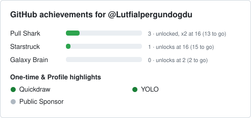

<h1 align="center">Lütfi Alper Gündoğdu</h1>

  Renewable energy resource assessment · simulation, data and machine learning 
  Energy Resources and Management · Çanakkale Onsekiz Mart University

  
  
  

English · [Türkçe](#türkçe)

## About me

I study how much renewable energy Türkiye's seas and skies can deliver, and at what cost. My work combines physical simulation (the System Advisor Model through PySAM), open reanalysis and satellite data (Copernicus Marine, ERA5, NASA POWER) and machine learning, and I turn the results into desktop tools; the Wave Energy App also explains its own methods and equations.

## Projects

### 🌊 Wave Energy App · private repository

Windows desktop decision-support tool for wave energy in Turkish seas.

- Computes annual energy, capacity factor and levelised cost of energy for reference wave energy converters (RM3, RM5, RM6) with SAM 2026.7.3.
- Covers the Çanakkale study area and all four Turkish seas, with territorial waters.
- Compares devices, sites, data sources and years; checks results against machine-learning surrogates, regional regression and a design of experiments; evaluates the research hypotheses H1–H3 automatically (H1 and H2 against preset thresholds).
- Guided six-step interface in Turkish and English, an end-to-end method page with sourced equations, and DOCX/PDF reports.

`Python` `PySAM` `scikit-learn` `statsmodels` `pandas` `JavaScript` `Leaflet` `Plotly` `pywebview`

### ☀️ [Güneş Enerjisi Potansiyeli](https://github.com/Lutfialpergundogdu/Gunes_enerjisi_potansiyeli)

Desktop application that estimates solar energy potential for a chosen location and date range from NASA POWER data, calculates energy by panel type, and forecasts future values with machine learning.

`Python` `tkinter` `scikit-learn` `matplotlib` `SQLite`

## Research

- **Wave Energy Assessment through Simulation and Machine Learning in the Çanakkale Region** · manuscript in preparation.

## Tools

## GitHub achievements

Refreshed by a scheduled GitHub Action from <a href="https://github.com/Lutfialpergundogdu/gh-achievements">gh-achievements</a>.

---

## Türkçe

Türkiye'nin denizlerinin ve güneşinin ne kadar yenilenebilir enerji sağlayabileceğini ve bunun maliyetini araştırıyorum. Fiziksel simülasyonu (PySAM üzerinden SAM), açık yeniden analiz ve uydu verisini (Copernicus Marine, ERA5, NASA POWER) ve makine öğrenmesini birleştirip sonuçları masaüstü araçlarına dönüştürüyorum; Wave Energy App yöntemini ve denklemlerini de kendisi anlatır.

- **Wave Energy App** (özel depo): Türkiye denizleri için dalga enerjisi karar destek programı. Referans dalga enerjisi dönüştürücüleri (RM3, RM5, RM6) için yıllık enerji, kapasite faktörü ve LCOE'yi SAM 2026.7.3 ile hesaplar; cihazları, yerleri, veri kaynaklarını ve yılları karşılaştırır; makine öğrenmesi, bölgesel regresyon ve tasarım deneyiyle sınar; H1–H3 hipotezlerini otomatik değerlendirir (H1 ve H2'yi sabit eşiklerle); Türkçe ve İngilizce rapor üretir.
- **[Güneş Enerjisi Potansiyeli](https://github.com/Lutfialpergundogdu/Gunes_enerjisi_potansiyeli)**: Seçilen yer ve tarih aralığı için NASA POWER verisinden güneş enerjisi potansiyelini hesaplayan, panel türüne göre enerji çıkaran ve makine öğrenmesiyle ileriye dönük tahmin yapan masaüstü uygulaması.
- **Makale (hazırlanıyor):** *Wave Energy Assessment through Simulation and Machine Learning in the Çanakkale Region*.
